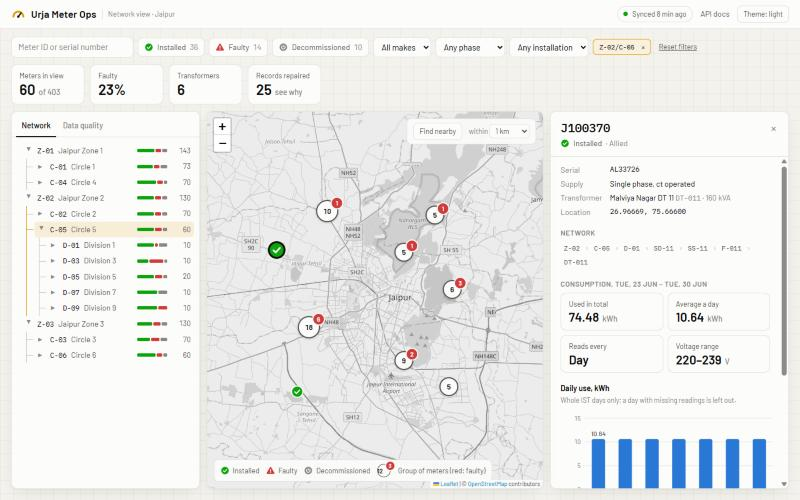
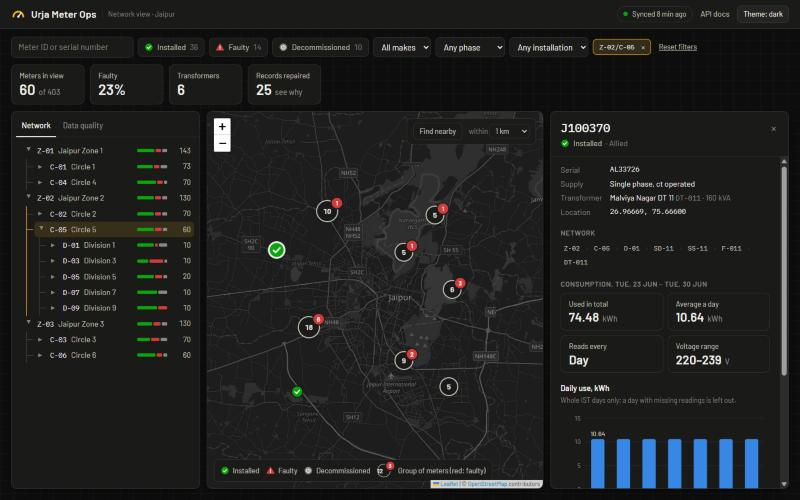
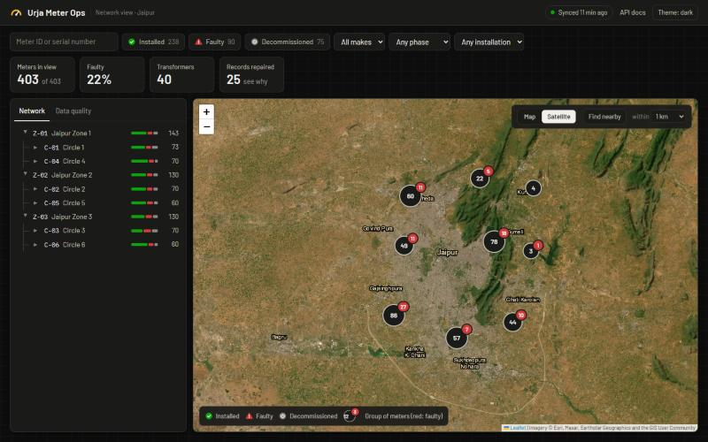

# Urja Meter Web Client

A modern, responsive React web dashboard for the **Urja Meter API**. Built for operations and field desk engineers to monitor smart meters, explore the distribution network hierarchy, view recent consumption charts, and inspect data quality on a single screen.



---

## Features

- **Interactive Map:**
  - Displays all 403 meters with status-coded markers (Installed, Faulty, Decommissioned).
  - High-density clustering groups nearby meters at high zooms with a badge highlighting faulty meters.
  - **Map / Satellite Toggle:** Switch seamlessly between OpenStreetMap street view and Esri World Imagery satellite aerial tiles with place names.
- **Electrical Single-Line Network Tree:**
  - Visualizes the 7-level power network (`Zone → Circle → Division → Subdivision → Substation → Feeder → DT`).
  - Active path traced in amber; selecting any branch instantly filters meters on the map.
  - Distribution Transformers show capacity (kVA) and load distribution.
- **Meter Detail & Consumption Analysis:**
  - Shows meter details, coordinates, and exact breadcrumb hierarchy `Name (Code)`.
  - Daily consumption bar charts (calculated across full IST days) and 30-minute interval interval consumption charts.
  - Anomaly detection: Flags decommissioned meters that are still actively recording energy consumption.
- **Data Quality Inspector:**
  - Reports all repaired hierarchy records (majority-vote resolution for damaged copies).
  - Lists ambiguous codes reused across multiple parent branches.
- **Accessible & Adaptive Design:**
  - **Colorblind-safe:** Status markers never rely solely on color (check mark for installed, warning sign for faulty, power-off for decommissioned).
  - **Light & Dark Themes:** Automatic system sync or manual toggle powered by the View Transitions API with circular ripple animations.
  - Self-hosted fonts (*Barlow* and *IBM Plex Mono*), requiring no third-party web fonts.

---

## Screenshots

````carousel

<!-- slide -->

<!-- slide -->

````

---

## Getting Started

### Prerequisites

- **Node.js 20 or newer** (tested with Node 24)
- **Urja Meter API** backend service running on `http://localhost:3000` (see [`../urja-meter-API`](../urja-meter-API/README.md))

### Installation & Run

1. **Install dependencies:**
   ```bash
   npm install
   ```

2. **Start the development server:**
   ```bash
   npm run dev
   ```

3. Open **`http://localhost:5173`** in your browser.

The Vite dev server automatically proxies all `/api/*` requests to the Urja Meter API running at `http://127.0.0.1:3000`.

---